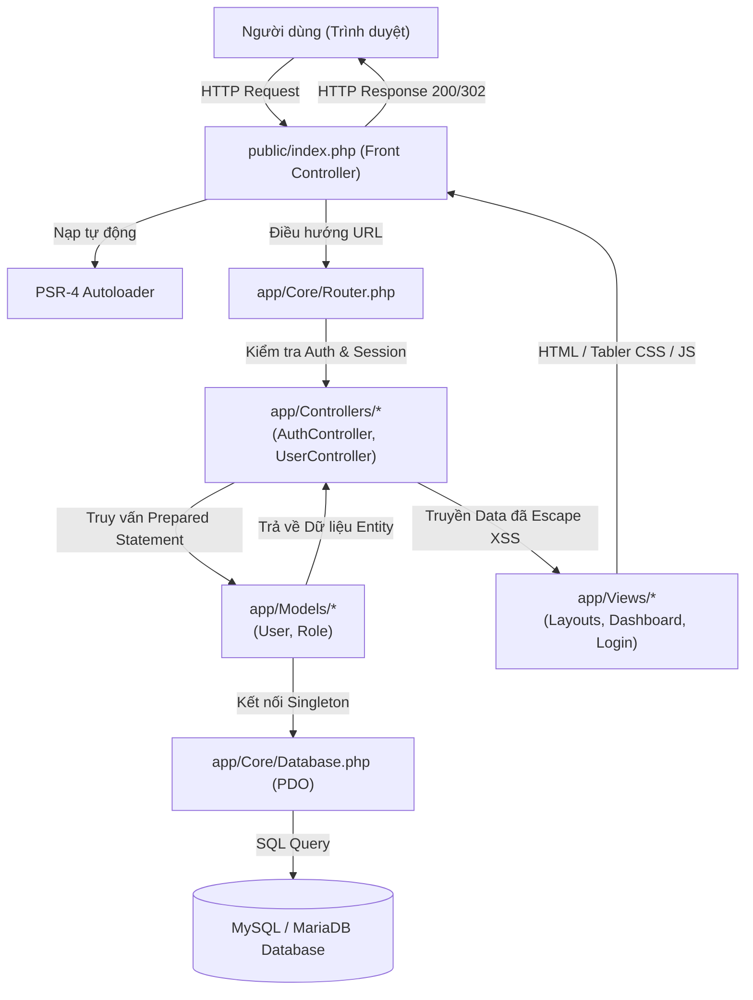
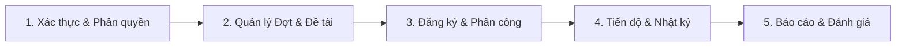

# Website Quản lý và Theo dõi Tiến độ Thực tập & Đồ án Sinh viên

> Hệ thống thông tin quản lý tập trung và giám sát tiến độ thực tập doanh nghiệp, đồ án tốt nghiệp dành cho các cơ sở giáo dục đại học.

---

## I. GIỚI THIỆU ĐỀ TÀI

### 1. Tên đề tài
**Xây dựng website quản lý và theo dõi tiến độ thực tập và đồ án sinh viên.**

### 2. Lý do xây dựng
Tại các trường đại học, hoạt động thực tập doanh nghiệp và thực hiện đồ án tốt nghiệp là hai học phần then chốt nhằm chuẩn bị cho sinh viên bước vào môi trường lao động thực tế. Tuy nhiên, quy trình quản lý hiện nay tại nhiều đơn vị vẫn còn đối mặt với nhiều bất cập:
- **Phân tán dữ liệu:** Thông tin đăng ký đề tài, phân công giảng viên và doanh nghiệp thường được lưu trữ rải rác trên file Excel, email hoặc văn bản giấy, dễ xảy ra thất lạc và khó đồng bộ.
- **Khó khăn trong giám sát tiến độ:** Giảng viên hướng dẫn và Bộ môn khó theo dõi sát sao tiến độ định kỳ của sinh viên trong suốt thời gian thực tập tại doanh nghiệp.
- **Đánh giá thiếu đa chiều:** Việc chấm điểm chưa có công cụ hỗ trợ bộ tiêu chí Rubric chuẩn hóa để kết hợp công bằng giữa đánh giá của Giảng viên và Người hướng dẫn tại Doanh nghiệp.
- **Nhu cầu tin học hóa:** Cần thiết phải có một nền tảng trực tuyến tập trung, minh bạch, bảo mật và phân quyền rõ ràng cho tất cả các bên tham gia.

### 3. Mục tiêu đề tài
- **Đối với Sinh viên:** Dễ dàng tìm kiếm thông tin đợt thực tập/đồ án, đăng ký nguyện vọng đề tài, cập nhật nhật ký thực tập, nộp báo cáo tiến độ định kỳ và tra cứu kết quả đánh giá.
- **Đối với Giảng viên:** Theo dõi tiến độ thực hiện của từng sinh viên được phân công, góp ý trực tiếp trên báo cáo, nhắc nhở hạn nộp và chấm điểm theo tiêu chí Rubric minh bạch.
- **Đối với Trưởng bộ môn & Phòng đào tạo:** Quản lý mở đợt thực tập/đồ án, phê duyệt danh mục đề tài, phân công giảng viên hướng dẫn - phản biện, kiểm soát toàn diện và xuất báo cáo thống kê.
- **Đối với Doanh nghiệp:** Tiếp nhận sinh viên thực tập, quản lý công việc tại cơ sở và phản hồi kết quả đánh giá năng lực thực tế của sinh viên về Nhà trường.

### 4. Phạm vi hệ thống
Hệ thống thiết kế hỗ trợ 6 nhóm tác nhân chính:
1. **Quản trị viên (Admin):** Quản trị hệ thống, người dùng, vai trò và phân quyền.
2. **Phòng đào tạo (Training Dept):** Quản lý chung các đợt thực tập, đồ án toàn trường theo niên khóa.
3. **Trưởng bộ môn (Department Head):** Phê duyệt đề tài, phân công giảng viên và giám sát bộ môn.
4. **Giảng viên (Lecturer):** Hướng dẫn sinh viên, duyệt tiến độ và chấm điểm đồ án.
5. **Sinh viên (Student):** Đăng ký đề tài, nộp báo cáo và theo dõi kết quả.
6. **Doanh nghiệp (Enterprise):** Đăng tin tuyển dụng thực tập, xác nhận và đánh giá sinh viên.

---

## II. CÔNG NGHỆ SỬ DỤNG

| Thành phần | Công nghệ / Thư viện | Vai trò trong hệ thống |
| :--- | :--- | :--- |
| **Ngôn ngữ lập trình** | **PHP 8.2 thuần** (Pure PHP) | Không dùng framework bên ngoài (Laravel, Symfony, CI), tự xây dựng kiến trúc MVC thuần túy, hướng đối tượng (OOP) theo chuẩn PSR-4. |
| **Cơ sở dữ liệu** | **MySQL / MariaDB** (10.4.x) | Lưu trữ quan hệ với công cụ lưu trữ InnoDB, bảng mã UTF-8 (`utf8mb4_unicode_ci`), toàn vẹn dữ liệu qua khóa ngoại (Foreign Keys) và ràng buộc toàn vẹn. |
| **Tương tác CSDL** | **PDO (PHP Data Objects)** | Kết nối chuẩn, chế độ `ATTR_EMULATE_PREPARES = false`, sử dụng Prepared Statements để phòng chống triệt để tấn công SQL Injection. |
| **Kiến trúc ứng dụng** | **MVC Pattern** | Tách bạch 3 lớp: Model (Dữ liệu), View (Hiển thị), Controller (Điều khiển luồng nghiệp vụ) kết hợp Front Controller duy nhất. |
| **Giao diện người dùng** | **Tabler Bootstrap 5** | Bộ template Admin Dashboard chuyên nghiệp (HTML5, CSS3, Tabler Icons), thiết kế Responsive Web Design thích ứng mọi thiết bị. |
| **Máy chủ Web cục bộ** | **XAMPP (Apache & MySQL)** | Chạy ứng dụng trên máy chủ web Apache (Port 80/443) và dịch vụ CSDL MySQL (Port 3306). |
| **Quản lý mã nguồn** | **Git & GitHub** | Áp dụng mô hình Git Flow tối giản (nhánh `main`, `develop` và các nhánh tính năng `feature/*`). |

---

## III. KIẾN TRÚC HỆ THỐNG & CẤU TRÚC THƯ MỤC

### 1. Kiến trúc phân tầng MVC & Luồng hoạt động



### 2. Cấu trúc thư mục chi tiết

```text
internship-management/
├── app/
│   ├── Core/                       # Các lớp hạt nhân của hệ thống
│   │   ├── Database.php            # Kết nối PDO Singleton an toàn, ẩn thông tin lỗi
│   │   ├── Router.php              # Phân tích URL, đăng ký GET/POST, hỗ trợ XAMPP subfolder
│   │   └── Controller.php          # Base Controller hỗ trợ render, redirect, escape XSS
│   ├── Controllers/                # Tầng Điều khiển tiếp nhận nghiệp vụ
│   │   ├── AuthController.php      # Xác thực đăng nhập, đăng xuất, Session, CSRF, RBAC
│   │   ├── UserController.php      # Quản lý tài khoản, gán vai trò, hồ sơ cá nhân
│   │   ├── InternshipPeriodController.php # Quản lý các đợt thực tập / đồ án
│   │   ├── TopicController.php     # Quản lý CRUD đề tài, phân quyền đề xuất
│   │   ├── TopicApprovalController.php # Xét duyệt đề tài, lịch sử phê duyệt / từ chối
│   │   └── TopicWishController.php # Đăng ký và sắp xếp nguyện vọng đề tài sinh viên
│   ├── Models/                     # Tầng Mô hình dữ liệu
│   │   ├── User.php                # Thao tác bảng users và liên kết user_roles
│   │   ├── Role.php                # Thao tác bảng roles
│   │   ├── InternshipPeriod.php    # Thao tác bảng internship_periods
│   │   ├── Topic.php               # Thao tác bảng topics
│   │   ├── TopicApproval.php       # Thao tác bảng topic_approvals
│   │   └── TopicWish.php           # Thao tác bảng topic_wishes
│   └── Views/                      # Tầng Giao diện người dùng
│       ├── layouts/                # Khung giao diện dùng chung
│       │   ├── header.php          # Navbar trên, dropdown tài khoản & CSS Tabler
│       │   ├── sidebar.php         # Menu điều hướng phân quyền theo vai trò
│       │   └── footer.php          # Chân trang & nhúng Tabler JS nội bộ
│       ├── auth/
│       │   └── login.php           # Form đăng nhập Tabler căn giữa có token CSRF
│       └── dashboard/
│           └── index.php           # Bảng điều khiển tổng quan cá nhân hóa theo vai trò
├── config/
│   ├── database.example.php        # Tệp cấu hình CSDL mẫu
│   └── database.php                # Cấu hình CSDL cục bộ thực tế (loại khỏi Git)
├── database/
│   ├── internship_management.sql   # Tệp CSDL tổng hợp toàn diện (7 bảng + dữ liệu mẫu)
│   ├── internship_management_full.sql # Bản sao đồng bộ của tệp CSDL tổng hợp
│   └── schema.sql                  # Kịch bản DDL tạo bảng (roles, users, user_roles)
├── docs/                           # Tài liệu kỹ thuật chuẩn mực (7 tài liệu)
│   ├── REQUIREMENTS.md             # Đặc tả yêu cầu nghiệp vụ 6 vai trò
│   ├── DATABASE_DESIGN.md          # Thiết kế CSDL 13 bảng 3NF & sơ đồ ERD
│   ├── SYSTEM_ARCHITECTURE.md      # Kiến trúc thuần MVC, Router & RBAC
│   ├── INTEGRATION_GUIDE.md        # Hướng dẫn tích hợp cho lập trình viên
│   ├── USER_GUIDE.md               # Cẩm nang sử dụng cho 6 tác nhân
│   ├── INSTALLATION_GUIDE.md       # Hướng dẫn cài đặt và triển khai XAMPP
│   └── TEST_CASES.md               # Danh mục ca kiểm thử toàn diện
├── public/                         # Thư mục gốc công khai của Web Server (Entry Point)
│   ├── assets/                     # Tài nguyên tĩnh nội bộ (Tabler CSS, JS, Tabler Icons)
│   ├── .htaccess                   # Rewrite URL Apache về index.php & chặn duyệt thư mục
│   └── index.php                   # Front Controller duy nhất tiếp nhận request
├── tests/                          # Bộ kiểm thử tự động
│   ├── seed_dev.php                # Tạo dữ liệu mẫu và tài khoản thử nghiệm
│   ├── test_core.php               # Kiểm thử Autoload, Router, Core Framework (20 test cases)
│   └── test_auth.php               # Kiểm thử PDO, Bcrypt, CSRF, RBAC (44 test cases)
├── .gitignore                      # Danh mục loại trừ tệp nhạy cảm và rác
└── README.md                       # Tài liệu tổng thể dự án
```

---

## IV. HƯỚNG DẪN CÀI ĐẶT & CHẠY DỰ ÁN

### 1. Yêu cầu môi trường
- Máy tính đã cài đặt **XAMPP** (PHP $\ge$ 8.2).
- Đã khởi động dịch vụ **Apache** (cổng 80/443) và **MySQL XAMPP** (cổng mặc định 3306).
- Thư mục dự án nằm chính xác tại:
  ```text
  C:\xampp\htdocs\CNPM\internship-management
  ```

### 2. Các bước cài đặt chi tiết

#### Bước 1: Thiết lập cấu hình Cơ sở dữ liệu
Sao chép tệp mẫu `config/database.example.php` thành `config/database.php` (nếu chưa có):
```bash
cp config/database.example.php config/database.php
```
Nội dung file `config/database.php`:
```php
return [
    'host'     => '127.0.0.1',
    'port'     => 3306,
    'dbname'   => 'internship_management',
    'username' => 'root',
    'password' => '',
    'charset'  => 'utf8mb4',
];
```

#### Bước 2: Tạo Cơ sở dữ liệu & Cấu trúc bảng

##### Cách 1: Cài đặt mới 1-Click bằng 1 file SQL duy nhất (Khuyến nghị cho máy mới)
1. Mở phpMyAdmin tại: `http://localhost/phpmyadmin/` (hoặc mở MySQL CLI).
2. Tạo cơ sở dữ liệu mới:
   ```sql
   CREATE DATABASE IF NOT EXISTS `internship_management`
   CHARACTER SET utf8mb4 COLLATE utf8mb4_unicode_ci;
   ```
3. Nhập (Import) tệp cơ sở dữ liệu tổng hợp:
   - Chọn CSDL `internship_management` -> Chọn tab **Import (Nhập)**.
   - Chọn tệp: `database/internship_management_full.sql` -> Nhấn **Import**.
   - *Ghi chú:* Tệp này đã tích hợp đầy đủ 5 bảng chuẩn hóa (`roles`, `users`, `user_roles`, `internship_periods`, `topics`), 6 vai trò hệ thống, 2 tài khoản demo (`admin` / `Admin@123`, `sv001` / `Sv@12345`), 2 đợt cơ sở và 10 đề tài mẫu. Sau khi import tệp này, bạn **không cần** chạy thêm `seed_dev.php` hay `topics.sql`.

##### Cách 2: Nâng cấp tuần tự (Dành cho CSDL đã có từ các phiên bản trước)
> [!WARNING]
> Không import tệp `internship_management_full.sql` lên cơ sở dữ liệu đang có dữ liệu thật để tránh xung đột dữ liệu. Hãy sử dụng các migration tương ứng:
- Nếu thiếu bảng đợt: Chạy `database/migrations/create_internship_periods.sql`.
- Nếu thiếu cột ảnh đại diện: Chạy `database/migrations/add_avatar_path_to_users.sql`.
- Nếu thiếu bảng đề tài: Chạy `database/migrations/create_topics_table.sql`.
- Nạp thêm dữ liệu mẫu đề tài: Import `database/seeds/topics.sql`.

#### Bước 3: Nạp dữ liệu nền tảng bắt buộc (Chỉ cần nếu cài đặt theo Cách 2)
Nếu bạn cài đặt theo **Cách 1 (tệp full.sql)**, hãy bỏ qua bước này. Nếu cài đặt thủ công theo Cách 2, chạy:
```bash
C:
mpp\php\php.exe tests/seed_dev.php
```
Lệnh này sẽ khởi tạo:
- 6 vai trò hệ thống (`admin`, `training_dept`, `department_head`, `lecturer`, `student`, `enterprise`).
- 2 tài khoản thử nghiệm: `admin` (`Admin@123`) và `sv001` (`Sv@12345`).
- 2 đợt cơ sở: `HK1-2026-TT` và `HK2-2026-DA`.

#### Bước 4: Nạp dữ liệu mẫu đề tài (Chỉ cần nếu cài đặt theo Cách 2)
Nếu bạn cài đặt theo **Cách 1 (tệp full.sql)**, hãy bỏ qua bước này vì 10 đề tài mẫu đã được nạp sẵn.
Nếu cài đặt theo Cách 2, import tệp `database/seeds/topics.sql` qua phpMyAdmin hoặc MySQL CLI:
```bash
C:
mpp\mysql\bin\mysql.exe -u root -p internship_management < database/seeds/topics.sql
```
#### Bước 5: Kiểm tra và xác minh dữ liệu bằng câu lệnh SELECT
Kiểm tra dữ liệu đề tài vừa nạp bằng các truy vấn SQL:
```sql
-- 1. Xem danh sách 10 đề tài mẫu kèm thông tin đợt và người đề xuất:
SELECT
    t.id,
    t.code AS topic_code,
    t.name AS topic_name,
    t.type,
    t.status,
    t.max_students,
    p.code AS period_code,
    u.username AS proposer
FROM `topics` t
INNER JOIN `internship_periods` p ON t.period_id = p.id
INNER JOIN `users` u ON t.proposer_id = u.id
ORDER BY t.type ASC, t.id ASC;

-- 2. Thống kê phân bố đề tài theo trạng thái và loại:
SELECT `type`, `status`, COUNT(*) AS total
FROM `topics`
GROUP BY `type`, `status`;
```

#### Bước 6: Kiểm tra hoạt động hệ thống tự động (Automated Test Suites)
Chạy các bộ kiểm thử tự động để xác nhận toàn bộ hệ thống hoạt động ổn định:
```bash
# Kiểm tra Core Framework và Router (20/20 PASS):
C:\xampp\php\php.exe tests/test_core.php

# Kiểm tra Xác thực, RBAC và CSRF (44/44 PASS):
C:\xampp\php\php.exe tests/test_auth.php

# Kiểm tra Quản lý Người dùng (74/74 PASS):
C:\xampp\php\php.exe tests/test_user_management.php

# Kiểm tra Quản lý Đợt thực tập/đồ án (39/39 PASS):
C:\xampp\php\php.exe tests/test_internship_periods.php

# Kiểm tra Quản lý Đề tài (50/50 PASS):
C:\xampp\php\php.exe tests/test_topics.php

# Kiểm tra Xét duyệt Đề tài (66/66 PASS):
C:\xampp\php\php.exe tests/test_topic_approval.php

# Kiểm tra Đăng ký Nguyện vọng Đề tài (48/48 PASS):
C:\xampp\php\php.exe tests/test_topic_wishes.php

# Kiểm tra quyền truy cập đề tài (13/13 PASS):
C:\xampp\php\php.exe tests/test_topic_access.php

# Kiểm tra Giao diện Sidebar & Quyền hạn (58/58 PASS):
C:\xampp\php\php.exe tests/test_sidebar.php

# Kiểm tra Ảnh đại diện người dùng (26/26 PASS):
C:\xampp\php\php.exe tests/test_avatar.php
```

#### Bước 7: Truy cập website trên trình duyệt
Mở trình duyệt và truy cập theo đường dẫn:
```text
http://localhost/CNPM/internship-management/public/
```
Hệ thống sẽ tự động chuyển hướng đến màn hình Đăng nhập giao diện Tabler Bootstrap 5.

---

## V. CÁC TÀI KHOẢN VÀ PHÂN QUYỀN TRẢI NGHIỆM

### 1. Thông tin tài khoản kiểm thử có sẵn

| Tên đăng nhập | Email | Mật khẩu mặc định | Vai trò chính | Quyền hạn giao diện |
| :--- | :--- | :--- | :---: | :--- |
| `admin` | `admin@example.com` | `Admin@123` | **Quản trị viên** | Xem Dashboard quản trị, hiển thị đủ 8 menu quản trị trên Sidebar, có quyền gọi các API quản lý người dùng. |
| `sv001` | `sv001@example.com` | `Sv@12345` | **Sinh viên** | Xem Dashboard sinh viên, hiển thị đủ 7 menu sinh viên trên Sidebar, bị chặn truy cập các chức năng quản trị. |

### 2. Cơ chế phân quyền hai tầng (UI & Backend RBAC)

1. **Phân quyền Giao diện (Frontend UI):**
   - **Với Quản trị viên:** Sidebar hiển thị 8 menu quản trị (*Bảng điều khiển, Quản lý người dùng, Quản lý vai trò và phân quyền, Quản lý đợt thực tập và đồ án, Quản lý phê duyệt đề tài, Phân công đề tài và giảng viên, Quản lý đơn vị thực tập, Thống kê và báo cáo*).
   - **Với Sinh viên:** Sidebar hiển thị 7 menu học tập (*Bảng điều khiển, Hồ sơ cá nhân, Xem đợt thực tập và đồ án, Đăng ký đề tài nguyện vọng, Theo dõi tiến độ, Nhật ký và nộp báo cáo, Xem kết quả đánh giá*). Tuyệt đối không thấy bất kỳ menu quản trị nào.
2. **Phân quyền Tầng sâu (Backend Middleware RBAC):**
   - Hệ thống không phụ thuộc vào việc ẩn/hiện menu để bảo mật. Mọi route nội bộ đều được bảo vệ bằng các phương thức kiểm tra tĩnh:
     - `AuthController::requireLogin()`: Bắt buộc đăng nhập trước khi vào route; chưa đăng nhập sẽ chuyển hướng ngay về `/login`.
     - `AuthController::requireRole('admin')`: Kiểm tra vai trò trong Session; người dùng không có vai trò phù hợp (như Sinh viên cố tình gõ URL `/users`) sẽ bị máy chủ trả về mã lỗi **HTTP 403 Forbidden**.

---

## VI. CÁC PHÂN HỆ CHỨC NĂNG CỐT LÕI

Dự án được thiết kế đồng bộ với các phân hệ chức năng:



### Các phân hệ chức năng đã hoàn thành
- [x] **Xác thực & Phân quyền Đa vai trò (Multi-Role RBAC):** Đăng nhập an toàn băm Bcrypt, bảo vệ CSRF, hỗ trợ 6 vai trò chính và tài khoản kiêm nhiệm.
- [x] **Quản lý Tài khoản & Hồ sơ:** Thêm, sửa, khóa/mở khóa tài khoản người dùng, tải ảnh đại diện an toàn.
- [x] **Quản lý Đợt thực tập / Đồ án:** Vòng đời đợt (draft/active/closed), kiểm soát thời hạn đăng ký.
- [x] **Quản lý & Xét duyệt Đề tài:** Giảng viên/Doanh nghiệp đề xuất, Trưởng bộ môn phê duyệt, lịch sử xét duyệt.
- [x] **Đăng ký Nguyện vọng:** Sinh viên đăng ký tối đa 3 nguyện vọng theo thứ tự ưu tiên trong đợt đang mở.
- [x] **Thuật toán Đối sánh & Phân công:** Tự động ghép cặp theo điểm GPA và thời gian nộp, điều chỉnh thủ công, công bố kết quả toàn trường.
- [x] **Quản lý Mốc tiến độ (Milestones):** Quản lý mốc thời gian, kiểm tra logic thời hạn, tự động phát hiện quá hạn, cung cấp REST API thống kê tiến độ.
- [x] **Nhật ký & Báo cáo Đa phiên bản:** Nhật ký tuần độc nhất theo phân công, upload file an toàn < 20MB (.pdf, .docx, .zip), lưu lịch sử phiên bản v1, v2... không ghi đè, ghi nhận nộp muộn is_late, nhận xét và yêu cầu nộp lại.

---

## VII. TÀI LIỆU KỸ THUẬT & HƯỚNG DẪN CHI TIẾT

Hệ thống tài liệu hoàn chỉnh của dự án được lưu trữ tập trung tại thư mục `docs/`:

- [Tài liệu Đặc tả Yêu cầu Nghiệp vụ (REQUIREMENTS.md)](docs/REQUIREMENTS.md)
- [Bản Thiết kế Cơ sở Dữ liệu 3NF (DATABASE_DESIGN.md)](docs/DATABASE_DESIGN.md)
- [Kiến trúc Hệ thống Phần mềm (SYSTEM_ARCHITECTURE.md)](docs/SYSTEM_ARCHITECTURE.md)
- [Hướng dẫn Tích hợp & Phát triển (INTEGRATION_GUIDE.md)](docs/INTEGRATION_GUIDE.md)
- [Hướng dẫn Sử dụng Hệ thống (USER_GUIDE.md)](docs/USER_GUIDE.md)
- [Hướng dẫn Cài đặt & Triển khai (INSTALLATION_GUIDE.md)](docs/INSTALLATION_GUIDE.md)
- [Danh sách Ca kiểm thử Hệ thống (TEST_CASES.md)](docs/TEST_CASES.md)
