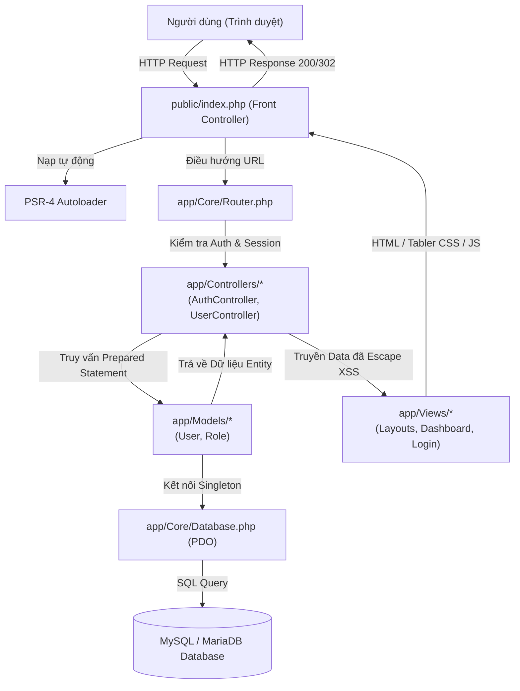
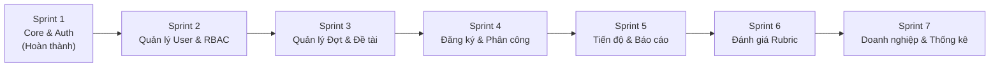

# Website Quản lý và Theo dõi Tiến độ Thực tập & Đồ án Sinh viên

> Hệ thống thông tin quản lý tập trung và giám sát tiến độ thực tập doanh nghiệp, đồ án tốt nghiệp dành cho các cơ sở giáo dục đại học.

---

## I. GIỚI THIỆU ĐỀ TÀI

### 1. Tên đề tài
**Xây dựng website quản lý và theo dõi tiến độ thực tập và đồ án sinh viên.**

### 2. Lý do xây dựng
Tại các trường đại học, hoạt động thực tập doanh nghiệp và thực hiện đồ án tốt nghiệp là hai học phần then chốt nhằm chuẩn bị cho sinh viên bước vào môi trường lao động thực tế. Tuy nhiên, quy trình quản lý hiện nay tại nhiều đơn vị vẫn còn đối mặt với nhiều bất cập:
- **Phân tán dữ liệu:** Thông tin đăng ký đề tài, phân công giảng viên và doanh nghiệp thường được lưu trữ rải rác trên file Excel, email hoặc văn bản giấy, dễ xảy ra thất lạc và khó đồng bộ.
- **Khó khăn trong giám sát tiến độ:** Giảng viên hướng dẫn và Bộ môn khó theo dõi sát sao tiến độ định kỳ của sinh viên trong suốt thời gian thực tập tại doanh nghiệp.
- **Đánh giá thiếu đa chiều:** Việc chấm điểm chưa có công cụ hỗ trợ bộ tiêu chí Rubric chuẩn hóa để kết hợp công bằng giữa đánh giá của Giảng viên và Người hướng dẫn tại Doanh nghiệp.
- **Nhu cầu tin học hóa:** Cần thiết phải có một nền tảng trực tuyến tập trung, minh bạch, bảo mật và phân quyền rõ ràng cho tất cả các bên tham gia.

### 3. Mục tiêu đề tài
- **Đối với Sinh viên:** Dễ dàng tìm kiếm thông tin đợt thực tập/đồ án, đăng ký nguyện vọng đề tài, cập nhật nhật ký thực tập, nộp báo cáo tiến độ định kỳ và tra cứu kết quả đánh giá.
- **Đối với Giảng viên:** Theo dõi tiến độ thực hiện của từng sinh viên được phân công, góp ý trực tiếp trên báo cáo, nhắc nhở hạn nộp và chấm điểm theo tiêu chí Rubric minh bạch.
- **Đối với Trưởng bộ môn & Phòng đào tạo:** Quản lý mở đợt thực tập/đồ án, phê duyệt danh mục đề tài, phân công giảng viên hướng dẫn - phản biện, kiểm soát toàn diện và xuất báo cáo thống kê.
- **Đối với Doanh nghiệp:** Tiếp nhận sinh viên thực tập, quản lý công việc tại cơ sở và phản hồi kết quả đánh giá năng lực thực tế của sinh viên về Nhà trường.

### 4. Phạm vi hệ thống
Hệ thống thiết kế hỗ trợ 6 nhóm tác nhân chính:
1. **Quản trị viên (Admin):** Quản trị hệ thống, người dùng, vai trò và phân quyền.
2. **Phòng đào tạo (Training Dept):** Quản lý chung các đợt thực tập, đồ án toàn trường theo niên khóa.
3. **Trưởng bộ môn (Department Head):** Phê duyệt đề tài, phân công giảng viên và giám sát bộ môn.
4. **Giảng viên (Lecturer):** Hướng dẫn sinh viên, duyệt tiến độ và chấm điểm đồ án.
5. **Sinh viên (Student):** Đăng ký đề tài, nộp báo cáo và theo dõi kết quả.
6. **Doanh nghiệp (Enterprise):** Đăng tin tuyển dụng thực tập, xác nhận và đánh giá sinh viên.

---

## II. CÔNG NGHỆ SỬ DỤNG

| Thành phần | Công nghệ / Thư viện | Vai trò trong hệ thống |
| :--- | :--- | :--- |
| **Ngôn ngữ lập trình** | **PHP 8.2 thuần** (Pure PHP) | Không dùng framework bên ngoài (Laravel, Symfony, CI), tự xây dựng kiến trúc MVC thuần túy, hướng đối tượng (OOP) theo chuẩn PSR-4. |
| **Cơ sở dữ liệu** | **MySQL / MariaDB** (10.4.x) | Lưu trữ quan hệ với công cụ lưu trữ InnoDB, bảng mã UTF-8 (`utf8mb4_unicode_ci`), toàn vẹn dữ liệu qua khóa ngoại (Foreign Keys) và ràng buộc toàn vẹn. |
| **Tương tác CSDL** | **PDO (PHP Data Objects)** | Kết nối chuẩn, chế độ `ATTR_EMULATE_PREPARES = false`, sử dụng Prepared Statements để phòng chống triệt để tấn công SQL Injection. |
| **Kiến trúc ứng dụng** | **MVC Pattern** | Tách bạch 3 lớp: Model (Dữ liệu), View (Hiển thị), Controller (Điều khiển luồng nghiệp vụ) kết hợp Front Controller duy nhất. |
| **Giao diện người dùng** | **Tabler Bootstrap 5** | Bộ template Admin Dashboard chuyên nghiệp (HTML5, CSS3, Tabler Icons), thiết kế Responsive Web Design thích ứng mọi thiết bị. |
| **Máy chủ Web cục bộ** | **XAMPP (Apache & MySQL)** | Chạy ứng dụng trên máy chủ web Apache (Port 80/443) và dịch vụ CSDL MySQL (Port 3306). |
| **Quản lý mã nguồn** | **Git & GitHub** | Áp dụng mô hình Git Flow tối giản (nhánh `main`, `develop` và các nhánh tính năng `feature/*`). |

---

## III. KIẾN TRÚC HỆ THỐNG & CẤU TRÚC THƯ MỤC

### 1. Kiến trúc phân tầng MVC & Luồng hoạt động



### 2. Cấu trúc thư mục chi tiết

```text
internship-management/
├── app/
│   ├── Core/                       # Các lớp hạt nhân của hệ thống
│   │   ├── Database.php            # Kết nối PDO Singleton an toàn, ẩn thông tin lỗi
│   │   ├── Router.php              # Phân tích URL, đăng ký GET/POST, hỗ trợ XAMPP subfolder
│   │   └── Controller.php          # Base Controller hỗ trợ render, redirect, escape XSS
│   ├── Controllers/                # Tầng Điều khiển tiếp nhận nghiệp vụ
│   │   ├── AuthController.php      # Xác thực đăng nhập, đăng xuất, Session, CSRF, RBAC
│   │   └── UserController.php      # Quản lý tài khoản, gán vai trò, hồ sơ cá nhân
│   ├── Models/                     # Tầng Mô hình dữ liệu
│   │   ├── User.php                # Thao tác bảng users và liên kết user_roles
│   │   └── Role.php                # Thao tác bảng roles
│   └── Views/                      # Tầng Giao diện người dùng
│       ├── layouts/                # Khung giao diện dùng chung
│       │   ├── header.php          # Navbar trên, dropdown tài khoản & CSS Tabler
│       │   ├── sidebar.php         # Menu điều hướng phân quyền theo vai trò
│       │   └── footer.php          # Chân trang & nhúng Tabler JS nội bộ
│       ├── auth/
│       │   └── login.php           # Form đăng nhập Tabler căn giữa có token CSRF
│       └── dashboard/
│           └── index.php           # Bảng điều khiển tổng quan cá nhân hóa theo vai trò
├── config/
│   ├── database.example.php        # Tệp cấu hình CSDL mẫu
│   └── database.php                # Cấu hình CSDL cục bộ thực tế (loại khỏi Git)
├── database/
│   └── schema.sql                  # Kịch bản DDL tạo bảng (roles, users, user_roles)
├── docs/                           # Tài liệu kỹ thuật
│   ├── database-design.md          # Thiết kế ERD & mô tả cấu trúc bảng
│   ├── git-workflow.md             # Quy trình phân nhánh Git Flow & Pull Request
│   └── sprint-1.md                 # Báo cáo nghiệm thu kỹ thuật Sprint 1
├── public/                         # Thư mục gốc công khai của Web Server (Entry Point)
│   ├── assets/                     # Tài nguyên tĩnh nội bộ (Tabler CSS, JS, Tabler Icons)
│   ├── .htaccess                   # Rewrite URL Apache về index.php & chặn duyệt thư mục
│   └── index.php                   # Front Controller duy nhất tiếp nhận request
├── tests/                          # Bộ kiểm thử tự động
│   ├── seed_dev.php                # Tạo dữ liệu mẫu và tài khoản thử nghiệm
│   ├── test_core.php               # Kiểm thử Autoload, Router, Core Framework (20 test cases)
│   └── test_auth.php               # Kiểm thử PDO, Bcrypt, CSRF, RBAC (44 test cases)
├── .gitignore                      # Danh mục loại trừ tệp nhạy cảm và rác
└── README.md                       # Tài liệu tổng thể dự án
```

---

## IV. HƯỚNG DẪN CÀI ĐẶT & CHẠY DỰ ÁN

### 1. Yêu cầu môi trường
- Máy tính đã cài đặt **XAMPP** (PHP $\ge$ 8.2).
- Đã khởi động dịch vụ **Apache** (cổng 80/443) và **MySQL XAMPP** (cổng mặc định 3306).
- Thư mục dự án nằm chính xác tại:
  ```text
  C:\xampp\htdocs\CNPM\internship-management
  ```

### 2. Các bước cài đặt chi tiết

#### Bước 1: Thiết lập cấu hình Cơ sở dữ liệu
Sao chép tệp mẫu `config/database.example.php` thành `config/database.php` (nếu chưa có):
```bash
cp config/database.example.php config/database.php
```
Nội dung file `config/database.php`:
```php
return [
    'host'     => '127.0.0.1',
    'port'     => 3306,
    'dbname'   => 'internship_management',
    'username' => 'root',
    'password' => '',
    'charset'  => 'utf8mb4',
];
```

#### Bước 2: Tạo Cơ sở dữ liệu & Nạp bảng nền tảng
1. Truy cập phpMyAdmin tại: `http://localhost/phpmyadmin/`
2. Tạo cơ sở dữ liệu mới: `internship_management` với Collation: `utf8mb4_unicode_ci`.
3. Nhập (Import) tệp SQL tại: `database/schema.sql` để tạo 3 bảng nền tảng `roles`, `users`, `user_roles`.

#### Bước 3: Nạp dữ liệu mẫu để thử nghiệm
Mở Command Prompt hoặc Terminal và chạy lệnh nạp dữ liệu:
```bash
C:\xampp\php\php.exe tests/seed_dev.php
```
Lệnh này sẽ tự động tạo đủ 6 vai trò hệ thống và 2 tài khoản thử nghiệm mặc định (`admin` và `sv001`).

#### Bước 4: Kiểm tra hoạt động hệ thống tự động
Chạy 2 bộ kiểm thử hồi quy để xác nhận hệ thống sẵn sàng 100%:
```bash
# Kiểm tra Core Framework, Router, Views, Database DDL (20/20 PASS):
C:\xampp\php\php.exe tests/test_core.php

# Kiểm tra PDO, Bcrypt Hash, CSRF, RBAC, Session (44/44 PASS):
C:\xampp\php\php.exe tests/test_auth.php
```

#### Bước 5: Truy cập website trên trình duyệt
Mở trình duyệt và truy cập theo đường dẫn:
```text
http://localhost/CNPM/internship-management/public/
```
Hệ thống sẽ tự động chuyển hướng đến màn hình Đăng nhập giao diện Tabler Bootstrap 5.

---

## V. CÁC TÀI KHOẢN VÀ PHÂN QUYỀN TRẢI NGHIỆM

### 1. Thông tin tài khoản kiểm thử có sẵn

| Tên đăng nhập | Email | Mật khẩu mặc định | Vai trò chính | Quyền hạn giao diện |
| :--- | :--- | :--- | :---: | :--- |
| `admin` | `admin@example.com` | `Admin@123` | **Quản trị viên** | Xem Dashboard quản trị, hiển thị đủ 8 menu quản trị trên Sidebar, có quyền gọi các API quản lý người dùng. |
| `sv001` | `sv001@example.com` | `Sv@12345` | **Sinh viên** | Xem Dashboard sinh viên, hiển thị đủ 7 menu sinh viên trên Sidebar, bị chặn truy cập các chức năng quản trị. |

### 2. Cơ chế phân quyền hai tầng (UI & Backend RBAC)

1. **Phân quyền Giao diện (Frontend UI):**
   - **Với Quản trị viên:** Sidebar hiển thị 8 menu quản trị (*Bảng điều khiển, Quản lý người dùng, Quản lý vai trò và phân quyền, Quản lý đợt thực tập và đồ án, Quản lý phê duyệt đề tài, Phân công đề tài và giảng viên, Quản lý đơn vị thực tập, Thống kê và báo cáo*).
   - **Với Sinh viên:** Sidebar hiển thị 7 menu học tập (*Bảng điều khiển, Hồ sơ cá nhân, Xem đợt thực tập và đồ án, Đăng ký đề tài nguyện vọng, Theo dõi tiến độ, Nhật ký và nộp báo cáo, Xem kết quả đánh giá*). Tuyệt đối không thấy bất kỳ menu quản trị nào.
2. **Phân quyền Tầng sâu (Backend Middleware RBAC):**
   - Hệ thống không phụ thuộc vào việc ẩn/hiện menu để bảo mật. Mọi route nội bộ đều được bảo vệ bằng các phương thức kiểm tra tĩnh:
     - `AuthController::requireLogin()`: Bắt buộc đăng nhập trước khi vào route; chưa đăng nhập sẽ chuyển hướng ngay về `/login`.
     - `AuthController::requireRole('admin')`: Kiểm tra vai trò trong Session; người dùng không có vai trò phù hợp (như Sinh viên cố tình gõ URL `/users`) sẽ bị máy chủ trả về mã lỗi **HTTP 403 Forbidden**.

---

## VI. KẾ HOẠCH PHÁT TRIỂN 7 SPRINT

Dự án được xây dựng và triển khai theo mô hình Agile / Scrum bao gồm 7 Sprint hoàn chỉnh:



### Sprint 1: Khởi tạo Kiến trúc MVC Thuần, Cơ sở dữ liệu & Xác thực (ĐÃ HOÀN THÀNH)
- [x] Thiết lập kiến trúc MVC thuần trên PHP 8.2, cơ chế Autoload PSR-4.
- [x] Xây dựng Singleton `Database.php` kết nối PDO an toàn, ẩn thông tin nhạy cảm.
- [x] Xây dựng `Router.php` hỗ trợ GET, POST, HEAD, tự chuẩn hóa URL trong thư mục con XAMPP.
- [x] Xây dựng Base `Controller.php` tích hợp hàm `render()`, `redirect()` và `escape()` chống XSS.
- [x] Thiết kế ERD tổng thể và khởi tạo Schema DDL 3 bảng nền tảng: `roles`, `users`, `user_roles`.
- [x] Tích hợp giao diện Tabler Bootstrap 5 chính thức, font Inter và icon Tabler Icons nội bộ.
- [x] Triển khai xác thực người dùng: Đăng nhập băm Bcrypt, chống timing attack, token bảo vệ CSRF.
- [x] Hoàn thiện phân quyền Sidebar và Dashboard chuyên biệt cho Quản trị viên và Sinh viên.
- [x] Xây dựng bộ kiểm thử tự động đạt kết quả 100% PASS (20 test core + 44 test auth).

### Sprint 2: Quản lý Người dùng, Phân quyền Đa vai trò & Hồ sơ cá nhân
- [ ] Xây dựng giao diện CRUD quản lý danh sách người dùng (`app/Views/users/index.php`).
- [ ] Chức năng thêm mới, chỉnh sửa, khóa/mở khóa tài khoản người dùng theo trạng thái.
- [ ] Chức năng gán/hủy đa vai trò cho người dùng (Một người dùng có thể vừa là Giảng viên vừa là Trưởng bộ môn).
- [ ] Hoàn thiện giao diện Hồ sơ cá nhân (`app/Views/users/profile.php`): cập nhật thông tin liên hệ, đổi mật khẩu an toàn.
- [ ] Cơ chế phân trang (Pagination), tìm kiếm theo họ tên/mã số và lọc theo vai trò.

### Sprint 3: Quản lý Đợt thực tập/Đồ án & Đề xuất/Phê duyệt Đề tài
- [ ] Thiết kế bảng `internship_terms` (Đợt thực tập/đồ án) và `topics` (Đề tài).
- [ ] Quản lý đợt thực tập/đồ án: Mở đợt, thiết lập thời hạn đăng ký, hạn nộp báo cáo, trạng thái đợt.
- [ ] Giảng viên và Doanh nghiệp gửi đề xuất đề tài mới kèm mô tả yêu cầu, số lượng sinh viên tối đa.
- [ ] Trưởng bộ môn duyệt/từ chối danh mục đề tài; công bố danh sách đề tài hợp lệ cho sinh viên.

### Sprint 4: Đăng ký Nguyện vọng & Ghép cặp / Phân công Giảng viên
- [ ] Sinh viên tra cứu danh mục đề tài đang mở và đăng ký nguyện vọng ưu tiên (Nguyện vọng 1, 2, 3).
- [ ] Chức năng duyệt nguyện vọng và ghép cặp sinh viên với đề tài (tự động theo điểm số hoặc thủ công).
- [ ] Bộ môn phân công Giảng viên hướng dẫn (GVHD) và Giảng viên phản biện (GVPB) cho từng đề tài.
- [ ] Thông báo kết quả phân công chính thức đến Giảng viên và Sinh viên.

### Sprint 5: Theo dõi Tiến độ, Nhật ký Thực tập & Nộp Báo cáo Định kỳ
- [ ] Thiết lập bảng kế hoạch làm việc (Milestones) theo tuần trong suốt đợt thực tập/đồ án.
- [ ] Sinh viên cập nhật nhật ký thực tập hàng tuần (công việc đã làm, khó khăn, dự kiến tiếp theo).
- [ ] Chức năng upload tệp báo cáo định kỳ (PDF, Word, ZIP) an toàn với giới hạn dung lượng và kiểm tra định dạng.
- [ ] Giảng viên hướng dẫn xem xét, nhận xét phản hồi trực tiếp và xác nhận tiến độ tuần của sinh viên.

### Sprint 6: Tiêu chí Đánh giá Rubric & Chấm điểm Đồ án / Đánh giá Doanh nghiệp
- [ ] Cấu hình bộ tiêu chí đánh giá chuẩn hóa (Rubric) theo thang điểm và trọng số quy định.
- [ ] Biểu mẫu dành cho Doanh nghiệp tiếp nhận: Nhận xét thái độ, kỹ năng thực tế và chấm điểm thực tập.
- [ ] Giảng viên hướng dẫn và Giảng viên phản biện chấm điểm đồ án theo từng tiêu chí Rubric.
- [ ] Tổng hợp điểm số tự động, xếp loại đánh giá và gửi kết quả về Phòng đào tạo.

### Sprint 7: Quản lý Đơn vị Thực tập, Tin tuyển dụng, Thống kê & Báo cáo Tổng kết
- [ ] Quản lý danh bạ doanh nghiệp đối tác, liên hệ người phụ trách và địa điểm thực tập.
- [ ] Cổng thông tin tin tuyển dụng thực tập dành cho sinh viên.
- [ ] Dashboard thống kê trực quan (biểu đồ tỷ lệ sinh viên hoàn thành, phân bố điểm, doanh nghiệp tiếp nhận nhiều nhất).
- [ ] Chức năng xuất dữ liệu báo cáo tổng kết ra file Excel và PDF phục vụ công tác lưu trữ của Nhà trường.
