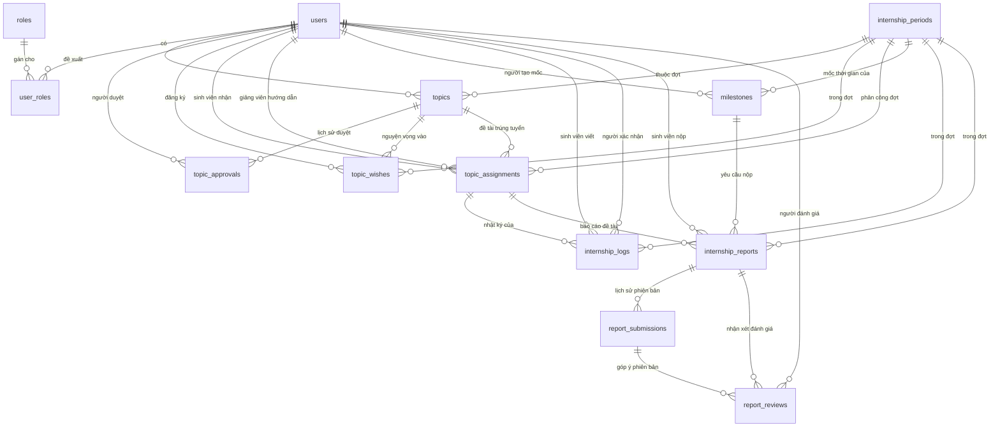

# THIẾT KẾ CƠ SỞ DỮ LIỆU TOÀN DIỆN (DATABASE DESIGN)
## DỰ ÁN: WEBSITE QUẢN LÝ VÀ THEO DÕI TIẾN ĐỘ THỰC TẬP & ĐỒ ÁN SINH VIÊN

- **Hệ quản trị CSDL:** MySQL / MariaDB (XAMPP Port 3306)
- **Engine lưu trữ:** InnoDB
- **Bảng mã ký tự & Đối chiếu:** `utf8mb4` | `utf8mb4_unicode_ci`
- **Mức độ chuẩn hóa:** Chuẩn hóa toàn diện mức 3NF (Third Normal Form)

---

## 1. SƠ ĐỒ THỰC THỂ LIÊN KẾT TOÀN DIỆN (FULL ENTITY-RELATIONSHIP DIAGRAM)

---

## 2. DANH MỤC 13 BẢNG VÀ CHI TIẾT CẤU TRÚC DỮ LIỆU

### 2.1. Nhóm 1: Người dùng và Phân quyền (Authentication & RBAC)

#### 1. Bảng `roles` (Danh mục Vai trò)
| Tên cột | Kiểu dữ liệu | Thuộc tính | Mô tả |
| :--- | :--- | :--- | :--- |
| `id` | `INT UNSIGNED` | `AUTO_INCREMENT`, `PK` | Khóa chính |
| `name` | `VARCHAR(50)` | `NOT NULL`, `UNIQUE` | Mã định danh vai trò (`admin`, `training_dept`, `department_head`, `lecturer`, `student`, `enterprise`) |
| `display_name` | `VARCHAR(100)` | `NOT NULL` | Tên hiển thị tiếng Việt |
| `description` | `VARCHAR(255)` | `NULL` | Mô tả quyền hạn của vai trò |
| `created_at` | `DATETIME` | `DEFAULT CURRENT_TIMESTAMP` | Thời điểm tạo |
| `updated_at` | `DATETIME` | `ON UPDATE CURRENT_TIMESTAMP`| Thời điểm cập nhật cuối |

#### 2. Bảng `users` (Tài khoản Người dùng)
| Tên cột | Kiểu dữ liệu | Thuộc tính | Mô tả |
| :--- | :--- | :--- | :--- |
| `id` | `INT UNSIGNED` | `AUTO_INCREMENT`, `PK` | Khóa chính |
| `username` | `VARCHAR(50)` | `NOT NULL`, `UNIQUE` | Tên đăng nhập / MSSV / MSGV |
| `email` | `VARCHAR(100)` | `NOT NULL`, `UNIQUE` | Email chính thức |
| `password` | `VARCHAR(255)` | `NOT NULL` | Mật khẩu băm Bcrypt |
| `full_name` | `VARCHAR(100)` | `NOT NULL` | Họ và tên |
| `phone` | `VARCHAR(20)` | `NULL` | Số điện thoại liên lạc |
| `avatar` | `VARCHAR(255)` | `NULL` | Đường dẫn ảnh đại diện |
| `status` | `TINYINT(1)` | `NOT NULL`, `DEFAULT 1` | Trạng thái: 1 (Hoạt động), 0 (Bị khóa) |
| `created_at` | `DATETIME` | `DEFAULT CURRENT_TIMESTAMP` | Thời điểm tạo tài khoản |
| `updated_at` | `DATETIME` | `ON UPDATE CURRENT_TIMESTAMP`| Thời điểm cập nhật cuối |

#### 3. Bảng `user_roles` (Phân quyền Người dùng - N:N)
| Tên cột | Kiểu dữ liệu | Thuộc tính | Mô tả |
| :--- | :--- | :--- | :--- |
| `user_id` | `INT UNSIGNED` | `PK`, `FK -> users(id)` | Khóa chính kết hợp, khóa ngoại người dùng |
| `role_id` | `INT UNSIGNED` | `PK`, `FK -> roles(id)` | Khóa chính kết hợp, khóa ngoại vai trò |
| `assigned_at`| `DATETIME` | `DEFAULT CURRENT_TIMESTAMP` | Thời điểm gán vai trò |

---

### 2.2. Nhóm 2: Đợt thực tập, Đề tài và Phân công (Periods, Topics & Assignments)

#### 4. Bảng `internship_periods` (Đợt Thực tập / Đồ án)
| Tên cột | Kiểu dữ liệu | Thuộc tính | Mô tả |
| :--- | :--- | :--- | :--- |
| `id` | `INT UNSIGNED` | `AUTO_INCREMENT`, `PK` | Khóa chính |
| `code` | `VARCHAR(50)` | `NOT NULL`, `UNIQUE` | Mã đợt (vd: HK1-2026-TT, HK2-2026-DA) |
| `name` | `VARCHAR(150)` | `NOT NULL` | Tên đợt hiển thị |
| `type` | `ENUM` | `'internship', 'graduation_project'` | Loại đợt thực tập hoặc đồ án tốt nghiệp |
| `start_date`| `DATE` | `NOT NULL` | Ngày bắt đầu |
| `end_date` | `DATE` | `NOT NULL` | Ngày kết thúc (`CHECK end_date >= start_date`) |
| `status` | `ENUM` | `'draft', 'active', 'closed'` | Trạng thái đợt |
| `description`| `TEXT` | `NULL` | Quy định, hướng dẫn chi tiết của đợt |
| `created_at` | `DATETIME` | `DEFAULT CURRENT_TIMESTAMP` | Thời điểm tạo bản ghi |
| `updated_at` | `DATETIME` | `ON UPDATE CURRENT_TIMESTAMP`| Thời điểm cập nhật cuối |

#### 5. Bảng `topics` (Danh mục Đề tài)
| Tên cột | Kiểu dữ liệu | Thuộc tính | Mô tả |
| :--- | :--- | :--- | :--- |
| `id` | `INT UNSIGNED` | `AUTO_INCREMENT`, `PK` | Khóa chính |
| `code` | `VARCHAR(50)` | `NOT NULL`, `UNIQUE` | Mã đề tài định danh |
| `name` | `VARCHAR(255)` | `NOT NULL` | Tên đề tài |
| `description`| `TEXT` | `NULL` | Mục tiêu, yêu cầu công việc |
| `type` | `ENUM` | `'internship', 'graduation_project'` | Loại đề tài |
| `period_id` | `INT UNSIGNED` | `NOT NULL`, `FK -> internship_periods` | Đợt áp dụng |
| `proposer_id`| `INT UNSIGNED` | `NOT NULL`, `FK -> users(id)` | Giảng viên hoặc Doanh nghiệp đề xuất |
| `max_students`| `TINYINT UNSIGNED`| `NOT NULL`, `DEFAULT 1` | Chỉ tiêu tiếp nhận tối đa |
| `status` | `ENUM` | `'draft', 'pending', 'approved', 'rejected'` | Trạng thái phê duyệt đề tài |
| `created_at` | `DATETIME` | `DEFAULT CURRENT_TIMESTAMP` | Thời điểm tạo |
| `updated_at` | `DATETIME` | `ON UPDATE CURRENT_TIMESTAMP`| Thời điểm cập nhật cuối |

#### 6. Bảng `topic_approvals` (Lịch sử Xét duyệt Đề tài)
| Tên cột | Kiểu dữ liệu | Thuộc tính | Mô tả |
| :--- | :--- | :--- | :--- |
| `id` | `INT UNSIGNED` | `AUTO_INCREMENT`, `PK` | Khóa chính |
| `topic_id` | `INT UNSIGNED` | `NOT NULL`, `FK -> topics(id)` | Đề tài được xét duyệt |
| `approver_id`| `INT UNSIGNED`| `NOT NULL`, `FK -> users(id)` | Cán bộ duyệt (Trưởng bộ môn) |
| `action` | `ENUM` | `'submit', 'approved', 'rejected'` | Hành động duyệt / từ chối |
| `comments` | `TEXT` | `NULL` | Lý do hoặc góp ý chỉnh sửa |
| `created_at` | `DATETIME` | `DEFAULT CURRENT_TIMESTAMP` | Thời điểm thực hiện |

#### 7. Bảng `topic_wishes` (Đăng ký Nguyện vọng của Sinh viên)
| Tên cột | Kiểu dữ liệu | Thuộc tính | Mô tả |
| :--- | :--- | :--- | :--- |
| `id` | `INT UNSIGNED` | `AUTO_INCREMENT`, `PK` | Khóa chính |
| `student_id`| `INT UNSIGNED` | `NOT NULL`, `FK -> users(id)` | Sinh viên đăng ký |
| `period_id` | `INT UNSIGNED` | `NOT NULL`, `FK -> internship_periods` | Đợt đăng ký |
| `topic_id` | `INT UNSIGNED` | `NOT NULL`, `FK -> topics(id)` | Đề tài mong muốn |
| `priority` | `TINYINT UNSIGNED`| `NOT NULL` | Thứ tự ưu tiên (1: NV1, 2: NV2, 3: NV3) |
| `status` | `ENUM` | `'pending', 'approved', 'rejected'` | Trạng thái xét nguyện vọng |
| `created_at` | `DATETIME` | `DEFAULT CURRENT_TIMESTAMP` | Thời điểm gửi nguyện vọng |
| *Ràng buộc* | `UNIQUE` | `(student_id, period_id, topic_id)` | Không được chọn trùng đề tài |
| *Ràng buộc* | `UNIQUE` | `(student_id, period_id, priority)` | Không được trùng thứ tự ưu tiên |

#### 8. Bảng `topic_assignments` (Phân công Đề tài & Giảng viên)
| Tên cột | Kiểu dữ liệu | Thuộc tính | Mô tả |
| :--- | :--- | :--- | :--- |
| `id` | `INT UNSIGNED` | `AUTO_INCREMENT`, `PK` | Khóa chính |
| `period_id` | `INT UNSIGNED` | `NOT NULL`, `FK -> internship_periods` | Đợt phân công |
| `student_id`| `INT UNSIGNED` | `NOT NULL`, `FK -> users(id)` | Sinh viên được phân công |
| `topic_id` | `INT UNSIGNED` | `NOT NULL`, `FK -> topics(id)` | Đề tài trúng tuyển |
| `lecturer_id`| `INT UNSIGNED`| `NOT NULL`, `FK -> users(id)` | Giảng viên hướng dẫn chính thức |
| `matched_wish_priority`| `TINYINT UNSIGNED`| `NULL` | Nguyện vọng trúng tuyển (1, 2, 3 hoặc null nếu phân thủ công) |
| `assignment_method` | `ENUM` | `'auto', 'manual'` | Phương thức: Tự động (auto) hoặc Thủ công (manual) |
| `status` | `ENUM` | `'draft', 'published', 'cancelled'` | Trạng thái: Dự thảo, Đã công bố, Đã hủy |
| `assigned_by`| `INT UNSIGNED`| `NOT NULL`, `FK -> users(id)` | Cán bộ thực hiện phân công |
| `notes` | `TEXT` | `NULL` | Ghi chú lý do phân công |
| `assigned_at`| `DATETIME` | `DEFAULT CURRENT_TIMESTAMP` | Thời điểm tạo phân công |
| `updated_at`| `DATETIME` | `ON UPDATE CURRENT_TIMESTAMP`| Thời điểm cập nhật cuối |
| *Ràng buộc* | `UNIQUE` | `(period_id, student_id)` | Mỗi sinh viên chỉ có 1 đề tài duy nhất trong đợt |

---

### 2.3. Nhóm 3: Tiến độ, Nhật ký và Báo cáo (Progress, Logs & Reports)

#### 9. Bảng `milestones` (Mốc Tiến độ Đợt)
| Tên cột | Kiểu dữ liệu | Thuộc tính | Mô tả |
| :--- | :--- | :--- | :--- |
| `id` | `INT UNSIGNED` | `AUTO_INCREMENT`, `PK` | Khóa chính |
| `period_id` | `INT UNSIGNED` | `NOT NULL`, `FK -> internship_periods` | Đợt áp dụng mốc tiến độ |
| `title` | `VARCHAR(255)` | `NOT NULL` | Tiêu đề mốc (vd: Nộp đề cương chi tiết) |
| `description`| `TEXT` | `NULL` | Tiêu chí hoàn thành, yêu cầu nội dung |
| `start_date`| `DATE` | `NOT NULL` | Ngày bắt đầu mở mốc |
| `due_date` | `DATETIME` | `NOT NULL` | Hạn chót hoàn thành / nộp báo cáo |
| `order_index`| `INT UNSIGNED`| `NOT NULL`, `DEFAULT 1` | Thứ tự hiển thị |
| `status` | `ENUM` | `'pending', 'active', 'completed', 'overdue', 'cancelled'` | Trạng thái mốc |
| `is_mandatory`| `TINYINT(1)`| `NOT NULL`, `DEFAULT 1` | 1: Bắt buộc, 0: Tùy chọn |
| `created_by`| `INT UNSIGNED` | `NOT NULL`, `FK -> users(id)` | Cán bộ tạo mốc |
| `created_at` | `DATETIME` | `DEFAULT CURRENT_TIMESTAMP` | Thời điểm tạo |
| `updated_at` | `DATETIME` | `ON UPDATE CURRENT_TIMESTAMP`| Thời điểm cập nhật |

#### 10. Bảng `internship_logs` (Nhật ký Thực tập Hàng tuần)
| Tên cột | Kiểu dữ liệu | Thuộc tính | Mô tả |
| :--- | :--- | :--- | :--- |
| `id` | `INT UNSIGNED` | `AUTO_INCREMENT`, `PK` | Khóa chính |
| `assignment_id`| `INT UNSIGNED`| `NOT NULL`, `FK -> topic_assignments` | Bản ghi phân công của SV |
| `student_id`| `INT UNSIGNED` | `NOT NULL`, `FK -> users(id)` | Sinh viên viết nhật ký |
| `period_id` | `INT UNSIGNED` | `NOT NULL`, `FK -> internship_periods` | Đợt thực tập |
| `week_number`| `INT UNSIGNED`| `NOT NULL` | Tuần thực tập thứ N |
| `log_date` | `DATE` | `NOT NULL` | Ngày kết thúc tuần |
| `work_done` | `TEXT` | `NOT NULL` | Nội dung công việc đã làm trong tuần |
| `difficulties`| `TEXT` | `NULL` | Khó khăn, vướng mắc cần giải quyết |
| `plan_next_week`| `TEXT` | `NULL` | Kế hoạch tuần tới |
| `status` | `ENUM` | `'draft', 'submitted', 'confirmed', 'rejected'` | Trạng thái nhật ký |
| `supervisor_comment`| `TEXT` | `NULL` | Nhận xét của người hướng dẫn |
| `confirmed_by`| `INT UNSIGNED`| `NULL`, `FK -> users(id)` | Người duyệt nhật ký |
| `confirmed_at`| `DATETIME` | `NULL` | Thời điểm duyệt |
| `created_at` | `DATETIME` | `DEFAULT CURRENT_TIMESTAMP` | Thời điểm tạo |
| *Ràng buộc* | `UNIQUE` | `(assignment_id, week_number)` | Mỗi tuần chỉ có 1 nhật ký duy nhất |

#### 11. Bảng `internship_reports` (Báo cáo theo Mốc)
| Tên cột | Kiểu dữ liệu | Thuộc tính | Mô tả |
| :--- | :--- | :--- | :--- |
| `id` | `INT UNSIGNED` | `AUTO_INCREMENT`, `PK` | Khóa chính |
| `milestone_id`| `INT UNSIGNED`| `NOT NULL`, `FK -> milestones` | Mốc tiến độ nộp bài |
| `assignment_id`| `INT UNSIGNED`| `NOT NULL`, `FK -> topic_assignments`| Bản ghi phân công của SV |
| `student_id`| `INT UNSIGNED` | `NOT NULL`, `FK -> users(id)` | Sinh viên nộp |
| `period_id` | `INT UNSIGNED` | `NOT NULL`, `FK -> internship_periods` | Đợt thực tập |
| `title` | `VARCHAR(255)` | `NOT NULL` | Tiêu đề báo cáo nộp |
| `current_version`| `INT UNSIGNED`| `NOT NULL`, `DEFAULT 1` | Phiên bản nộp hiện tại (v1, v2...) |
| `status` | `ENUM` | `'draft', 'submitted', 'reviewing', 'approved', 'rejected', 'resubmit_required'` | Trạng thái duyệt báo cáo |
| `grade` | `DECIMAL(4,2)` | `NULL` | Điểm đánh giá (thang điểm 10) |
| `submitted_at`| `DATETIME` | `DEFAULT CURRENT_TIMESTAMP` | Thời điểm nộp phiên bản mới nhất |
| *Ràng buộc* | `UNIQUE` | `(student_id, milestone_id)` | Mỗi sinh viên có 1 báo cáo tổng quát cho 1 mốc |

#### 12. Bảng `report_submissions` (Lịch sử Phiên bản Nộp Báo cáo)
| Tên cột | Kiểu dữ liệu | Thuộc tính | Mô tả |
| :--- | :--- | :--- | :--- |
| `id` | `INT UNSIGNED` | `AUTO_INCREMENT`, `PK` | Khóa chính |
| `report_id` | `INT UNSIGNED` | `NOT NULL`, `FK -> internship_reports`| Báo cáo cha |
| `version` | `INT UNSIGNED` | `NOT NULL`, `DEFAULT 1` | Lần nộp thứ mấy (1, 2, 3...) |
| `file_name` | `VARCHAR(255)` | `NOT NULL` | Tên tệp gốc sinh viên tải lên |
| `file_path` | `VARCHAR(255)` | `NOT NULL` | Đường dẫn lưu tệp trên máy chủ |
| `file_size` | `INT UNSIGNED` | `NOT NULL` | Dung lượng tệp (bytes) |
| `file_mime` | `VARCHAR(100)` | `NOT NULL` | Định dạng MIME (`application/pdf`...) |
| `file_ext` | `VARCHAR(20)` | `NOT NULL` | Đuôi tệp (`pdf`, `docx`, `zip`) |
| `student_note`| `TEXT` | `NULL` | Ghi chú tóm tắt nội dung chỉnh sửa của SV |
| `is_late` | `TINYINT(1)` | `NOT NULL`, `DEFAULT 0` | 1: Nộp muộn sau hạn chót, 0: Nộp đúng hạn |
| `submitted_at`| `DATETIME` | `DEFAULT CURRENT_TIMESTAMP` | Thời điểm tải lên |
| *Ràng buộc* | `UNIQUE` | `(report_id, version)` | Lưu độc lập từng phiên bản, không ghi đè |

#### 13. Bảng `report_reviews` (Lịch sử Nhận xét & Đánh giá)
| Tên cột | Kiểu dữ liệu | Thuộc tính | Mô tả |
| :--- | :--- | :--- | :--- |
| `id` | `INT UNSIGNED` | `AUTO_INCREMENT`, `PK` | Khóa chính |
| `report_id` | `INT UNSIGNED` | `NOT NULL`, `FK -> internship_reports`| Báo cáo được đánh giá |
| `submission_id`| `INT UNSIGNED`| `NULL`, `FK -> report_submissions` | Lần nộp cụ thể được chấm |
| `reviewer_id`| `INT UNSIGNED` | `NOT NULL`, `FK -> users(id)` | Giảng viên hoặc Cán bộ DN chấm |
| `decision` | `ENUM` | `'approved', 'rejected', 'resubmit_required', 'comment_only'` | Quyết định duyệt |
| `comments` | `TEXT` | `NOT NULL` | Nội dung nhận xét, góp ý chi tiết |
| `edit_requirements`| `TEXT` | `NULL` | Yêu cầu sinh viên sửa đổi khi nộp lại |
| `score` | `DECIMAL(4,2)` | `NULL` | Điểm đánh giá (thang điểm 10) |
| `reviewed_at`| `DATETIME` | `DEFAULT CURRENT_TIMESTAMP` | Thời điểm hoàn thành đánh giá |

---

## 3. CHIẾN LƯỢC CHỈ MỤC VÀ TỐI ƯU HIỆU NĂNG (INDEXING STRATEGY)

1. **Khóa ngoại (Foreign Keys):** Toàn bộ các cột khóa ngoại đều được đánh chỉ mục đơn (`INDEX`) để tối ưu hóa phép nối bảng (`JOIN`).
2. **Chỉ mục tổng hợp (Composite Indexes):**
   - `(period_id, status)` trên `internship_periods`, `topics`, `milestones`: Tối ưu hóa truy vấn lọc theo trạng thái trong một đợt.
   - `(student_id, period_id)` trên `topic_wishes`: Tăng tốc độ kiểm tra quyền đăng ký và hiển thị danh sách nguyện vọng.
   - `(period_id, order_index)` trên `milestones`: Tối ưu hóa sắp xếp lộ trình mốc thời gian.
3. **Chỉ mục tìm kiếm (Search Indexes):**
   - Đánh chỉ mục trên `due_date`, `log_date`, `is_late` để phục vụ tác vụ quét nền tự động đồng bộ trạng thái quá hạn.
