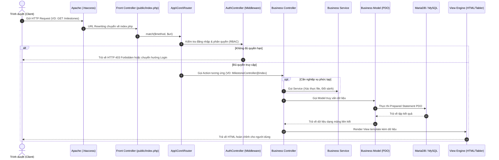

# KIẾN TRÚC HỆ THỐNG PHẦN MỀM (SYSTEM ARCHITECTURE)
## DỰ ÁN: WEBSITE QUẢN LÝ VÀ THEO DÕI TIẾN ĐỘ THỰC TẬP & ĐỒ ÁN SINH VIÊN

- **Mô hình kiến trúc:** MVC thuần (Model - View - Controller Pure PHP 8.2)
- **Hệ cơ sở dữ liệu:** MySQL / MariaDB thông qua PHP Data Objects (PDO)
- **Giao diện người dùng:** HTML5 / CSS3 / JavaScript, Bootstrap 5.3, Tabler UI Dashboard Framework

---

## 1. CẤU TRÚC THƯ MỤC TỔNG THỂ (PROJECT DIRECTORY STRUCTURE)

```text
internship-management/
├── app/
│   ├── Controllers/            # Bộ điều khiển xử lý logic điều hướng và nghiệp vụ
│   │   ├── AuthController.php              # Đăng nhập, đăng xuất, phiên làm việc
│   │   ├── DashboardController.php         # Bảng điều khiển theo vai trò
│   │   ├── InternshipPeriodController.php  # Quản lý đợt thực tập / đồ án
│   │   ├── MilestoneController.php         # Quản lý mốc thời gian & tiến độ
│   │   ├── TopicApprovalController.php     # Xét duyệt và phản biện đề tài
│   │   ├── TopicAssignmentController.php   # Thuật toán đối sánh và phân công
│   │   ├── TopicController.php             # Danh mục đề tài
│   │   ├── TopicWishController.php         # Đăng ký nguyện vọng sinh viên
│   │   └── UserController.php              # Quản lý tài khoản và phân quyền
│   │
│   ├── Core/                   # Các lớp lõi của framework MVC
│   │   ├── Controller.php      # Base Controller (render view, send JSON)
│   │   ├── Database.php        # Lớp quản lý kết nối PDO Singleton
│   │   └── Router.php          # Lớp định tuyến URL và điều phối request
│   │
│   ├── Models/                 # Tầng dữ liệu tương tác CSDL bằng PDO
│   │   ├── InternshipLog.php               # Nhật ký tuần
│   │   ├── InternshipPeriod.php            # Đợt thực tập/đồ án
│   │   ├── InternshipReport.php            # Báo cáo và phiên bản nộp
│   │   ├── Milestone.php                   # Mốc tiến độ
│   │   ├── ReportReview.php                # Nhận xét và đánh giá điểm
│   │   ├── Role.php                        # Danh mục vai trò
│   │   ├── Topic.php                       # Đề tài
│   │   ├── TopicApproval.php               # Lịch sử duyệt
│   │   ├── TopicAssignment.php             # Phân công chính thức
│   │   ├── TopicWish.php                   # Nguyện vọng sinh viên
│   │   └── User.php                        # Người dùng và vai trò
│   │
│   ├── Services/               # Tầng dịch vụ nghiệp vụ độc lập
│   │   ├── ReportUploadService.php         # Xác thực và lưu trữ tệp an toàn
│   │   └── TopicMatchingService.php        # Thuật toán đối sánh tự động
│   │
│   └── Views/                  # Giao diện hiển thị (HTML/PHP)
│       ├── layouts/            # Layout dùng chung (header, sidebar, footer)
│       ├── auth/               # Màn hình đăng nhập
│       ├── dashboard/          # Giao diện dashboard các tác nhân
│       ├── milestones/         # Giao diện mốc tiến độ (index, create, edit, show)
│       ├── periods/            # Giao diện đợt thực tập
│       ├── topics/             # Giao diện đề tài và xét duyệt
│       └── assignments/        # Giao diện phân công và kết quả
│
├── config/                     # Cấu hình hệ thống (kết nối CSDL)
│   ├── database.php            # Tệp kết nối cục bộ (được bỏ qua bởi Git)
│   └── database.example.php    # Tệp cấu hình mẫu
│
├── database/                   # CSDL, Migration và Dữ liệu mẫu
│   ├── schema.sql              # Cấu trúc CSDL nền tảng
│   ├── internship_management.sql # Tệp CSDL tổng hợp toàn diện
│   ├── migrations/             # Các tập lệnh migration độc lập
│   └── seeds/                  # Dữ liệu mẫu phục vụ phát triển
│
├── docs/                       # Tài liệu kỹ thuật chuẩn mực của dự án
├── public/                     # Thư mục gốc công khai của Web Server (Document Root)
│   ├── index.php               # Điểm nhập cảnh duy nhất (Front Controller)
│   ├── .htaccess               # URL Rewriting điều hướng vào index.php
│   ├── assets/                 # CSS, JavaScript, Fonts, Images
│   └── uploads/                # Thư mục lưu trữ tệp người dùng tải lên
│
└── tests/                      # Bộ kiểm thử tự động (PHP CLI Automation Tests)
```

---

## 2. LUỒNG ĐIỀU PHỐI REQUEST (REQUEST LIFECYCLE)



---

## 3. CÁC THÀNH PHẦN KIẾN TRÚC NỀN TẢNG (CORE COMPONENTS)

### 3.1. Front Controller & Định tuyến (Routing Engine)
- Toàn bộ mọi yêu cầu HTTP gửi đến ứng dụng đều được tập trung xử lý tại điểm vào duy nhất: [public/index.php](file:///c:/xampp/htdocs/CNPM/internship-management/public/index.php).
- Lớp `App\Core\Router` hỗ trợ định tuyến theo phương thức HTTP (`GET`, `POST`) với cơ chế phân tích URL linh hoạt, cho phép định nghĩa route tĩnh và route động có tham số.

### 3.2. Cơ chế Phân quyền Đa vai trò (Multi-Role RBAC Middleware)
- Mỗi người dùng trong hệ thống có thể sở hữu một hoặc nhiều vai trò cùng lúc thông qua bảng nối `user_roles`.
- Lớp `AuthController` cung cấp các phương thức bảo vệ:
  * `AuthController::requireLogin()`: Bắt buộc phiên đăng nhập hợp lệ.
  * `AuthController::requireRole(...$roles)`: Kiểm tra tài khoản có ít nhất một trong các vai trò được cấp phép.
  * `AuthController::hasRole($role)`: Kiểm tra xem tài khoản có vai trò cụ thể hay không.

### 3.3. Tầng Dữ liệu & Giao dịch an toàn (Database & Transaction Management)
- Lớp `App\Core\Database` quản lý một thể hiện duy nhất (Singleton Pattern) của đối tượng `PDO`.
- Tắt tính năng giả lập prepared statements (`PDO::ATTR_EMULATE_PREPARES => false`) để tận dụng cơ chế prepared statement native của MySQL, phòng chống triệt để SQL Injection.
- Toàn bộ các Model hỗ trợ cơ chế bọc giao dịch an toàn lồng nhau qua kiểm tra `$pdo->inTransaction()`, cho phép thực thi an toàn trong các luồng nghiệp vụ phức tạp và trong các bộ kiểm thử tự động có rollback.

### 3.4. Tầng Dịch vụ Độc lập (Service Layer)
- Tách biệt logic nghiệp vụ phức tạp khỏi Controller:
  * `TopicMatchingService`: Thuật toán phân công tự động, xử lý giải quyết xung đột theo điểm GPA và thời gian nộp, bảo đảm chỉ tiêu đề tài và hạn ngạch của giảng viên.
  * `ReportUploadService`: Đóng gói logic bảo mật tệp tin tải lên, phân tích mã byte MIME type thực tế, lọc phần mở rộng hợp lệ và đổi tên file bằng chuỗi băm ngẫu nhiên.
