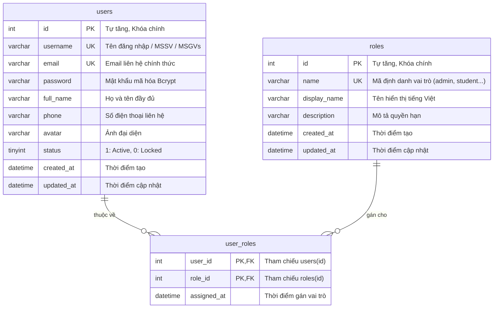

# THIẾT KẾ CƠ SỞ DỮ LIỆU (DATABASE DESIGN)

Dự án: **Website Quản lý và Theo dõi Tiến độ Thực tập & Đồ án Sinh viên**  
Giai đoạn: **Sprint 1 - Foundation Database & Multi-role RBAC**  
Hệ quản trị CSDL: **MySQL / MariaDB (XAMPP Port 3306)**  
Storage Engine: **InnoDB** | Collation: **utf8mb4_unicode_ci**

---

## 1. Sơ đồ thực thể liên kết nền tảng (Sprint 1 ERD)

Dưới đây là thiết kế chuẩn hóa mức 3NF cho phân hệ Người dùng và Phân quyền đa vai trò (Multi-role RBAC) theo tài liệu chức năng được giao:

---

## 2. Chi tiết các bảng nền tảng (Sprint 1)

### 2.1. Bảng `roles` (Danh mục Vai trò)
Lưu trữ danh sách vai trò người dùng trong hệ thống. Một cá nhân có thể mang nhiều vai trò (ví dụ: Giảng viên vừa là Trưởng bộ môn, vừa là Giảng viên phản biện).

| Cột | Kiểu dữ liệu | Thuộc tính | Mô tả |
| :--- | :--- | :--- | :--- |
| `id` | `INT UNSIGNED` | `AUTO_INCREMENT`, `PRIMARY KEY` | Khóa chính duy nhất của vai trò |
| `name` | `VARCHAR(50)` | `NOT NULL`, `UNIQUE` | Mã vai trò (vd: `admin`, `training_dept`, `department_head`, `lecturer`, `student`, `enterprise`) |
| `display_name`| `VARCHAR(100)`| `NOT NULL` | Tên hiển thị (vd: Quản trị viên, Sinh viên, Giảng viên...) |
| `description` | `VARCHAR(255)`| `NULL` | Mô tả chi tiết quyền hạn |
| `created_at`  | `DATETIME`     | `DEFAULT CURRENT_TIMESTAMP` | Thời điểm tạo bản ghi |
| `updated_at`  | `DATETIME`     | `DEFAULT CURRENT_TIMESTAMP ON UPDATE CURRENT_TIMESTAMP` | Thời điểm cập nhật cuối |

### 2.2. Bảng `users` (Tài khoản Người dùng)
Lưu trữ thông tin xác thực và hồ sơ cơ bản của người dùng trên toàn hệ thống.

| Cột | Kiểu dữ liệu | Thuộc tính | Mô tả |
| :--- | :--- | :--- | :--- |
| `id` | `INT UNSIGNED` | `AUTO_INCREMENT`, `PRIMARY KEY` | Khóa chính định danh người dùng |
| `username` | `VARCHAR(50)` | `NOT NULL`, `UNIQUE`, `INDEX` | Tên tài khoản, MSSV hoặc Mã GV |
| `email` | `VARCHAR(100)` | `NOT NULL`, `UNIQUE`, `INDEX` | Email chính thức phục vụ thông báo |
| `password` | `VARCHAR(255)` | `NOT NULL` | Chuỗi băm mật khẩu chuẩn Bcrypt an toàn |
| `full_name`| `VARCHAR(100)` | `NOT NULL` | Họ và tên đầy đủ |
| `phone` | `VARCHAR(20)` | `NULL` | Số điện thoại liên lạc |
| `avatar` | `VARCHAR(255)` | `NULL` | Đường dẫn ảnh đại diện |
| `status` | `TINYINT(1)` | `DEFAULT 1`, `INDEX` | 1: Hoạt động (Active), 0: Tạm khóa (Suspended) |
| `created_at` | `DATETIME` | `DEFAULT CURRENT_TIMESTAMP` | Thời điểm khởi tạo |
| `updated_at` | `DATETIME` | `DEFAULT CURRENT_TIMESTAMP ON UPDATE CURRENT_TIMESTAMP` | Thời điểm cập nhật cuối |

### 2.3. Bảng `user_roles` (Phân quyền Đa vai trò)
Bảng trung gian thiết lập quan hệ $N - N$ giữa `users` và `roles`.

| Cột | Kiểu dữ liệu | Thuộc tính | Mô tả |
| :--- | :--- | :--- | :--- |
| `user_id` | `INT UNSIGNED` | `NOT NULL`, `PK`, `FK` | Tham chiếu tới `users(id)` |
| `role_id` | `INT UNSIGNED` | `NOT NULL`, `PK`, `FK` | Tham chiếu tới `roles(id)` |
| `assigned_at` | `DATETIME` | `DEFAULT CURRENT_TIMESTAMP` | Thời điểm được gán vai trò |

**Ràng buộc khóa ngoại (Foreign Key Constraints):**
- `fk_user_roles_user`: `FOREIGN KEY (user_id) REFERENCES users(id) ON DELETE CASCADE ON UPDATE CASCADE`
- `fk_user_roles_role`: `FOREIGN KEY (role_id) REFERENCES roles(id) ON DELETE CASCADE ON UPDATE CASCADE`

---

## 3. Bản đồ Thực thể Tổng thể mở rộng cho các Sprint tiếp theo

Dựa trên 8 phân hệ chức năng trong tài liệu yêu cầu của Giảng viên, các bảng tiếp theo sẽ liên kết trực tiếp vào bảng nền tảng `users`:

1. **Phân hệ Đợt & Hồ sơ**:
   - `periods`: Quản lý đợt thực tập / đồ án (học kỳ, năm học, mốc thời gian đăng ký, bảo vệ).
   - `student_profiles`: Mở rộng thông tin sinh viên (MSSV, lớp, ngành, GPA, CV, kỹ năng) liên kết `user_id`.
   - `lecturer_profiles`: Mở rộng thông tin giảng viên (bộ môn, học hàm/học vị, quota hướng dẫn).
   - `enterprise_profiles`: Thông tin doanh nghiệp (địa chỉ, lĩnh vực, đầu mối liên hệ).
2. **Phân hệ Đồ án & Ghép cặp**:
   - `topics`: Danh mục đề tài do GV hoặc SV đề xuất (tên, mục tiêu, công nghệ, quota SV, trạng thái duyệt).
   - `topic_wishes`: Nguyện vọng đăng ký đề tài của SV (thứ tự ưu tiên 1, 2, 3).
   - `matchings`: Kết quả ghép cặp sau khi chạy thuật toán (Gale-Shapley / Hungarian / Thủ công).
3. **Phân hệ Thực tập & Tiến độ**:
   - `internship_positions`: Tin tuyển dụng thực tập của doanh nghiệp.
   - `internship_registrations`: Sinh viên ứng tuyển hoặc đăng ký đơn vị thực tập tự tìm.
   - `progress_reports`: Báo cáo định kỳ / nhật ký thực tập hàng tuần.
4. **Phân hệ Đánh giá & Rubric**:
   - `rubrics`: Bộ tiêu chí chấm điểm và trọng số.
   - `evaluations`: Phiếu chấm điểm của GV hướng dẫn, phản biện, hội đồng và DN.
5. **Phân hệ Trao đổi & Lưu vết**:
   - `notifications`: Thông báo hệ thống và email.
   - `comments`: Trao đổi gắn với từng bài nộp báo cáo.
   - `audit_logs`: Nhật ký thao tác hệ thống.
