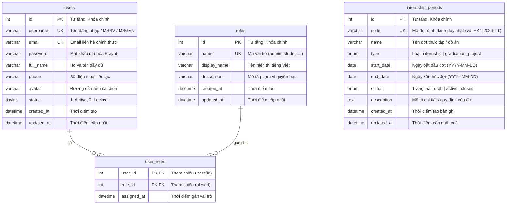

# THIẾT KẾ CƠ SỞ DỮ LIỆU (DATABASE DESIGN)

- Dự án: **Website Quản lý và Theo dõi Tiến độ Thực tập & Đồ án Sinh viên**
- Phiên bản: **Cập nhật mở rộng Quản lý Đợt thực tập / Đồ án**
- Hệ quản trị CSDL: **MySQL / MariaDB (XAMPP Port 3306)**
- Storage Engine: **InnoDB** | Collation: **utf8mb4_unicode_ci**

---

## 1. Sơ đồ Thực thể Liên kết Mở rộng (Extended ERD)

Dưới đây là sơ đồ thực thể liên kết chuẩn hóa mức 3NF thể hiện các bảng hiện có trong hệ thống và bảng mới triển khai `internship_periods`:



> **Lưu ý kiến trúc về quan hệ với bảng `users`:**  
> Bảng `internship_periods` đóng vai trò là danh mục đợt quản lý ở cấp độ đơn vị đào tạo. Trong giai đoạn hiện tại, đợt chưa tạo khóa ngoại trực tiếp tới `users` để đảm bảo độc lập nghiệp vụ. Khi các phân hệ tiếp theo (đăng ký đề tài, phân công giảng viên, danh sách sinh viên tham gia đợt) được triển khai, các bảng quan hệ phụ thuộc (như `period_students`, `topics`, `registrations`) sẽ tham chiếu đồng thời đến `internship_periods(id)` và `users(id)`.

---

## 2. Chi tiết các bảng đã triển khai thực tế

### 2.1. Bảng `roles` (Danh mục Vai trò Hệ thống)
Lưu trữ danh sách các vai trò chuẩn trong hệ thống phân quyền đa vai trò (Multi-role RBAC).

| Tên cột | Kiểu dữ liệu | Thuộc tính | Mô tả |
| :--- | :--- | :--- | :--- |
| `id` | `INT UNSIGNED` | `AUTO_INCREMENT`, `PRIMARY KEY` | Khóa chính duy nhất của vai trò |
| `name` | `VARCHAR(50)` | `NOT NULL`, `UNIQUE` | Mã định danh vai trò (`admin`, `training_dept`, `department_head`, `lecturer`, `student`, `enterprise`) |
| `display_name` | `VARCHAR(100)` | `NOT NULL` | Tên hiển thị tiếng Việt (Quản trị viên, Phòng đào tạo, Giảng viên...) |
| `description` | `VARCHAR(255)` | `NULL` | Mô tả chi tiết phạm vi quyền hạn của vai trò |
| `created_at` | `DATETIME` | `DEFAULT CURRENT_TIMESTAMP` | Thời điểm tạo bản ghi |
| `updated_at` | `DATETIME` | `DEFAULT CURRENT_TIMESTAMP ON UPDATE CURRENT_TIMESTAMP` | Thời điểm cập nhật cuối |

### 2.2. Bảng `users` (Tài khoản Người dùng)
Lưu trữ thông tin định danh, tài khoản đăng nhập và hồ sơ cá nhân cơ bản của người dùng.

| Tên cột | Kiểu dữ liệu | Thuộc tính | Mô tả |
| :--- | :--- | :--- | :--- |
| `id` | `INT UNSIGNED` | `AUTO_INCREMENT`, `PRIMARY KEY` | Khóa chính định danh tài khoản |
| `username` | `VARCHAR(50)` | `NOT NULL`, `UNIQUE`, `INDEX` | Tên đăng nhập / Mã sinh viên / Mã giảng viên |
| `email` | `VARCHAR(100)` | `NOT NULL`, `UNIQUE`, `INDEX` | Email chính thức phục vụ thông báo hệ thống |
| `password` | `VARCHAR(255)` | `NOT NULL` | Chuỗi băm mật khẩu Bcrypt an toàn (`PASSWORD_BCRYPT`) |
| `full_name` | `VARCHAR(100)` | `NOT NULL` | Họ và tên đầy đủ |
| `phone` | `VARCHAR(20)` | `NULL` | Số điện thoại liên lạc |
| `avatar` | `VARCHAR(255)` | `NULL` | Đường dẫn ảnh đại diện |
| `status` | `TINYINT(1)` | `DEFAULT 1`, `INDEX` | Trạng thái: `1` = Hoạt động (Active), `0` = Bị khóa (Locked) |
| `created_at` | `DATETIME` | `DEFAULT CURRENT_TIMESTAMP` | Thời điểm tạo tài khoản |
| `updated_at` | `DATETIME` | `DEFAULT CURRENT_TIMESTAMP ON UPDATE CURRENT_TIMESTAMP` | Thời điểm cập nhật cuối |

### 2.3. Bảng `user_roles` (Phân quyền Đa vai trò)
Bảng trung gian thiết lập quan hệ Nhiều - Nhiều ($N - N$) giữa tài khoản người dùng và vai trò.

| Tên cột | Kiểu dữ liệu | Thuộc tính | Mô tả |
| :--- | :--- | :--- | :--- |
| `user_id` | `INT UNSIGNED` | `NOT NULL`, `PK`, `FK` | Tham chiếu tới `users(id)` |
| `role_id` | `INT UNSIGNED` | `NOT NULL`, `PK`, `FK` | Tham chiếu tới `roles(id)` |
| `assigned_at` | `DATETIME` | `DEFAULT CURRENT_TIMESTAMP` | Thời điểm được gán vai trò |

**Ràng buộc khóa ngoại:**
- `fk_user_roles_user`: `FOREIGN KEY (user_id) REFERENCES users(id) ON DELETE CASCADE ON UPDATE CASCADE`
- `fk_user_roles_role`: `FOREIGN KEY (role_id) REFERENCES roles(id) ON DELETE CASCADE ON UPDATE CASCADE`

### 2.4. Bảng `internship_periods` (Quản lý Đợt thực tập và Đồ án)
Quản lý các đợt thực tập tốt nghiệp và đợt đồ án tốt nghiệp theo từng học kỳ, năm học.

| Tên cột | Kiểu dữ liệu | Thuộc tính | Mô tả |
| :--- | :--- | :--- | :--- |
| `id` | `INT UNSIGNED` | `AUTO_INCREMENT`, `PRIMARY KEY` | Khóa chính tự tăng |
| `code` | `VARCHAR(50)` | `NOT NULL`, `UNIQUE KEY` | Mã đợt duy nhất (vd: `HK1-2026-TT`, `HK2-2026-DA`) |
| `name` | `VARCHAR(150)` | `NOT NULL` | Tên đợt (vd: Đợt Thực tập tốt nghiệp Học kỳ 1 2026-2027) |
| `type` | `ENUM(...)` | `NOT NULL`, `INDEX` | Giá trị: `'internship'` (Thực tập) hoặc `'graduation_project'` (Đồ án) |
| `start_date` | `DATE` | `NOT NULL`, `INDEX` | Ngày bắt đầu đợt (định dạng `YYYY-MM-DD`) |
| `end_date` | `DATE` | `NOT NULL` | Ngày kết thúc đợt (định dạng `YYYY-MM-DD`) |
| `status` | `ENUM(...)` | `NOT NULL`, `DEFAULT 'draft'`, `INDEX` | Trạng thái: `'draft'` (Bản nháp), `'active'` (Đang diễn ra), `'closed'` (Đã đóng) |
| `description` | `TEXT` | `NULL` | Mô tả chi tiết, quy định, mốc tiến độ tóm tắt |
| `created_at` | `DATETIME` | `DEFAULT CURRENT_TIMESTAMP` | Thời điểm tạo bản ghi |
| `updated_at` | `DATETIME` | `DEFAULT CURRENT_TIMESTAMP ON UPDATE CURRENT_TIMESTAMP` | Thời điểm cập nhật cuối |

**Chỉ mục và Ràng buộc:**
- `uk_internship_periods_code`: `UNIQUE KEY (code)` đảm bảo không trùng mã đợt.
- `idx_internship_periods_status`: `INDEX (status)` tối ưu lọc theo trạng thái.
- `idx_internship_periods_type`: `INDEX (type)` tối ưu lọc theo loại đợt.
- `idx_internship_periods_dates`: `INDEX (start_date, end_date)` phục vụ tra cứu theo mốc thời gian.
- `chk_period_dates`: `CHECK (end_date >= start_date)` ngăn chặn lỗi logic ngày kết thúc trước ngày bắt đầu.

---

## 3. Quy tắc nghiệp vụ và Trạng thái Đợt (State Machine)

```
        ┌──────────────┐
        │    draft     │  (Đợt mới tạo, đang chuẩn bị cấu hình)
        └──────┬───────┘
               │  Mở đợt
               ▼
        ┌──────────────┐
  ┌────►│    active    │  (Đang diễn ra: mở đăng ký, cập nhật tiến độ)
  │     └──────┬───────┘
  │ Mở lại     │  Đóng đợt
  │            ▼
  │     ┌──────────────┐
  └─────┤    closed    │  (Đã kết thúc: khóa chỉnh sửa, chỉ xem lưu trữ)
        └──────────────┘
```

1. **Khởi tạo (`draft`):** Khi tạo mới, đợt mặc định ở trạng thái Bản nháp. Lúc này phòng đào tạo/quản trị viên có thể chỉnh sửa thông tin hoặc xóa đợt (chỉ được xóa khi ở trạng thái draft).
2. **Kích hoạt (`active`):** Khi chuyển sang Đang diễn ra, sinh viên và giảng viên bắt đầu tham gia quy trình đề tài/thực tập trong đợt này.
3. **Đóng đợt (`closed`):** Khi hết thời gian bảo vệ/nộp báo cáo, đợt được đóng lại để khóa dữ liệu điểm số và tiến độ.
4. **Mở lại (`closed` -> `active`):** Trong trường hợp đặc biệt (phúc khảo, nộp bổ sung có phê duyệt), quản trị viên có thể mở lại đợt.

---

## 4. Định hướng các phân hệ tiếp theo (Dự kiến triển khai sau)

*Phần này phân biệt rõ các bảng chưa triển khai để các thành viên chuẩn bị cấu trúc kết nối:*

1. **Phân hệ Hồ sơ chi tiết sinh viên & Giảng viên:**
   - `student_profiles`: `user_id` (FK), `class_name`, `major`, `gpa`, `cv_url`.
   - `lecturer_profiles`: `user_id` (FK), `department`, `academic_rank`, `max_students_quota`.
   - `enterprise_profiles`: `user_id` (FK), `company_name`, `address`, `contact_person`.
2. **Phân hệ Đề tài & Nguyện vọng:**
   - `topics`: `period_id` (FK), `creator_id` (FK), `title`, `description`, `technology`, `max_students`, `status`.
   - `topic_wishes`: `period_id` (FK), `student_id` (FK), `topic_id` (FK), `priority` (1, 2, 3).
   - `matchings`: `period_id` (FK), `topic_id` (FK), `student_id` (FK), `lecturer_id` (FK).
3. **Phân hệ Tiến độ & Đánh giá:**
   - `progress_reports`: `matching_id` (FK), `week_number`, `content`, `feedback`, `report_file`.
   - `rubrics`: `period_id` (FK), `criteria_name`, `weight`, `max_score`.
   - `evaluations`: `matching_id` (FK), `evaluator_id` (FK), `rubric_id` (FK), `score`, `comments`.
