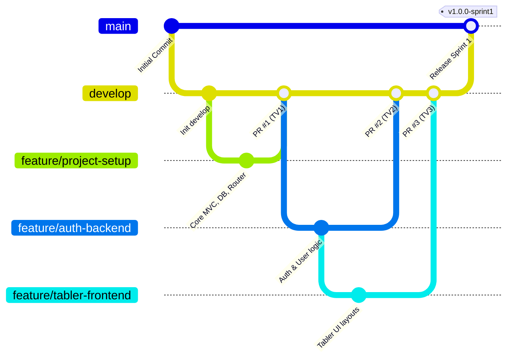

# QUY TRÌNH QUẢN LÝ MÃ NGUỒN VỚI GIT & GITHUB (GIT WORKFLOW)

Dự án: **Website Quản lý và Theo dõi Tiến độ Thực tập & Đồ án Sinh viên**  
Nhóm phát triển: **3 thành viên (Nhóm trưởng TV1, Thành viên TV2, Thành viên TV3)**

---

## 1. Mô hình phân nhánh (Branching Strategy)

Hệ thống áp dụng mô hình Git Flow tối giản, phân định rõ ràng giữa mã nguồn production, mã nguồn tích hợp kiểm thử và các nhánh tính năng:



### Chi tiết các nhánh chính:
1. `main`: Nhánh ổn định cao nhất (Production-ready). Chỉ nhận merge từ `develop` sau khi đã nghiệm thu toàn bộ Sprint và được Nhóm trưởng phê duyệt.
2. `develop`: Nhánh tích hợp chính của nhóm. Mọi tính năng sau khi hoàn thành sẽ tạo Pull Request vào đây.

### Các nhánh tính năng của Sprint 1 (Feature Branches):
- `feature/project-setup` (TV1 - Nhóm trưởng): Khởi tạo kiến trúc MVC thuần, Router, Database PDO, Base Controller, cấu trúc CSDL và tài liệu.
- `feature/auth-backend` (TV2): Triển khai nghiệp vụ xác thực đăng nhập/đăng xuất, Model User, Role, session và mã hóa Bcrypt.
- `feature/tabler-frontend` (TV3): Tích hợp giao diện Tabler Bootstrap 5, layout Header/Sidebar/Footer, màn hình đăng nhập và Dashboard.

---

## 2. Quy trình làm việc hàng ngày (Daily Workflow)

### Bước 1: Khởi tạo repo và checkout nhánh làm việc
```bash
# 1. Clone repository về máy (nếu chưa clone)
git clone <URL_REPO>
cd internship-management

# 2. Cập nhật nhánh develop mới nhất
git checkout develop
git pull origin develop

# 3. Tạo và chuyển sang nhánh tính năng được phân công
git checkout -b feature/auth-backend      # Dành cho TV2
# hoặc:
git checkout -b feature/tabler-frontend   # Dành cho TV3
```

### Bước 2: Commit mã nguồn theo quy chuẩn (Conventional Commits)
Thông điệp commit phải ngắn gọn, rõ ràng theo cấu trúc:  
`<loại>(<phạm vi>): <mô tả ngắn bằng tiếng Việt hoặc tiếng Anh>`

Ví dụ:
- `feat(core): implement PDO Database connection and Router`
- `feat(auth): implement login with password_verify and session`
- `style(ui): integrate Tabler bootstrap 5 navbar and sidebar`
- `fix(router): resolve subfolder path parsing issue on XAMPP`
- `docs(db): update ERD documentation for multi-role design`

### Bước 3: Đẩy nhánh lên GitHub và tạo Pull Request (PR)
```bash
# Đẩy nhánh tính năng lên remote
git push origin feature/auth-backend
```
1. Truy cập giao diện GitHub của Repository.
2. Tạo **New Pull Request** với base branch là `develop` và compare branch là `feature/...`.
3. Điền mô tả chi tiết:
   - Các task đã hoàn thành.
   - Các file đã thay đổi.
   - Hướng dẫn test để người review kiểm tra.
4. Gán **Reviewer** là Nhóm trưởng (TV1).

### Bước 4: Review và Phê duyệt Merge
- Nhóm trưởng kiểm tra syntax, logic an toàn và tiêu chí nghiệm thu.
- Nếu đạt, Nhóm trưởng sẽ thực hiện Merge PR vào nhánh `develop`.
- Tuyệt đối không tự ý merge hoặc force push (`git push -f`) lên các nhánh `main` và `develop`.
